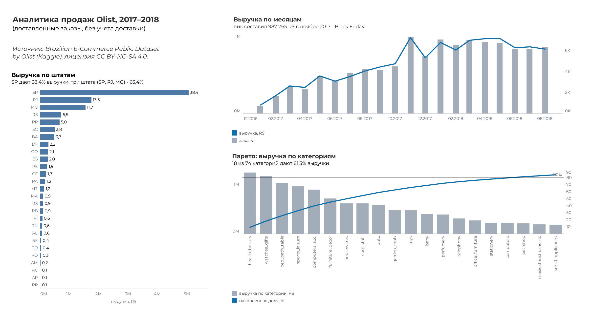

# Аналитика продаж онлайн-торговли (Olist, 2017–2018): SQL, PostgreSQL, Excel

Учебное портфолио проект: загрузка CSV, создание аналитической витрины, бизнес-выводы и финансовый блок (план-факт, декомпозиция выручки, аномалии, прогноз с проверкой точности, сценарная модель).

> **Статус:** выполнены база данных, проверка качества, витрина, аналитические запросы, финансовый блок и сценарная модель в Excel. Опубликован дашборд в Tableau Public: [открыть](https://public.tableau.com/views/Olist_sales_dashboard/Dashboard1). Раздел «Дальнейшие шаги» в конце.

## 1. Цель и вопросы

Практика полного цикла работы аналитика: подготовка данных, проверка их качества, построение витрины и ответы на бизнес-вопросы:

- как менялась выручка и число заказов по месяцам, где сезонные пики;
- есть ли зависимость от отдельных категорий (анализ Парето);
- как выручка распределена по регионам клиентов;
- как факт соотносится с планом и за счет чего растет выручка (объем или средний чек);
- есть ли аномальные дни и насколько точно можно прогнозировать выручку;
- каким может быть итог 2018 года при разных допущениях (сценарная модель).

## 2. Данные и лицензия

- Источник: [Brazilian E-Commerce Public Dataset by Olist](https://www.kaggle.com/datasets/olistbr/brazilian-ecommerce) (Kaggle).
- 9 CSV-файлов, заказы за 2016–2018 годы, обезличенные данные.
- Лицензия **CC BY-NC-SA 4.0**: указание авторства, некоммерческое использование. Проект учебный и некоммерческий.
- Исходные CSV в репозиторий не включены, их нужно скачать отдельно.

## 3. Стек

PostgreSQL 18 (Postgres.app, macOS), DBeaver Community, Excel (сценарная модель), Tableau Public (дашборд).

## 4. Структура репозитория

| Файл | Назначение |
|---|---|
| `sql/00_create_database.sql` | создание базы `olist` |
| `sql/01_create_tables.sql` | DDL: 9 таблиц с типами данных и ключами |
| `sql/02_check_row_counts.sql` | контроль количества строк после загрузки |
| `sql/03_data_quality_checks.sql` | проверки качества данных |
| `sql/04_create_v_sales.sql` | аналитическая витрина `v_sales` и ее сверка с источником |
| `sql/05_monthly_revenue.sql` | выручка, заказы, средний чек и MoM по месяцам |
| `sql/06_category_pareto.sql` | выручка по категориям, доли и накопленная доля (Парето) |
| `sql/07_revenue_by_state.sql` | заказы, выручка, доля и средний чек по штатам |
| `sql/08_plan_fact.sql` | план-факт по месяцам и нарастающим итогом, декомпозиция выручки на эффекты объема и среднего чека |
| `sql/09_anomalies.sql` | поиск аномальных дней по z-оценке |
| `sql/10_forecast_backtest.sql` | наивный прогноз и скользящее среднее, бэктест на 2018 году, MAPE |
| `excel/Olist_сценарная_модель.xlsx` | сценарная модель выручки на сентябрь–декабрь 2018 (формулы, допущения, график) |
| `tableau_data/monthly.csv`, `categories.csv`, `states.csv` | агрегированные таблицы для дашборда (результаты запросов 05, 06, 07; сырых данных Olist нет) |
| `images/dashboard.png` | скриншот дашборда |

## 5. Загрузка данных (`01_create_tables.sql`, `02_check_row_counts.sql`)

Данные загружены в PostgreSQL в заранее созданные таблицы (структура описана в `01_create_tables.sql`). Идентификаторы и почтовые индексы хранятся как `text` (чтобы не терять ведущие нули), деньги как `numeric(10,2)`, даты как `timestamp`.

Контроль количества строк после загрузки:

| Таблица | Строк |
|---|---|
| customers | 99 441 |
| geolocation | 1 000 163 |
| order_items | 112 650 |
| order_payments | 103 886 |
| order_reviews | 99 224 |
| orders | 99 441 |
| products | 32 951 |
| sellers | 3 095 |
| product_category_name_translation | 71 |

**Особенность загрузки:** `order_reviews` содержит комментарии с переносами строк внутри кавычек. Мастер импорта DBeaver такой файл разбирает неверно, поэтому таблица загружена командой PostgreSQL `COPY ... WITH (FORMAT csv, HEADER true)`.

## 6. Проверка качества данных (`03_data_quality_checks.sql`)

| Проверка | Результат |
|---|---|
| Статусы заказов | `delivered` 96 478 (97,0%); `shipped` 1 107; `canceled` 625; `unavailable` 609; `invoiced` 314; `processing` 301; `created` 5; `approved` 2. Сумма равна числу заказов (99 441) |
| Позиции без заказа | 0 |
| Заказы без позиций | 775: `unavailable` 603, `canceled` 164, `created` 5, `invoiced` 2, `shipped` 1. Среди `delivered` таких нет |
| Период данных | сентябрь 2016 — октябрь 2018. В 2016 году всего 329 заказов, ноябрь 2016 отсутствует; в сентябре 2018 — 16 заказов, в октябре — 4. Полные месяцы: **январь 2017 — август 2018** |
| Сверка денег | товары 13 591 643,70 + доставка 2 251 909,54 = 15 843 553,24 против платежей 16 008 872,12 (расхождение около 1%) |
| Где расхождение | по `delivered` всего 2 831 (299 заказов); около 98% расхождения (161 709) приходится на `canceled` и `unavailable`, где платеж есть, а товара нет |
| Доставленный заказ без платежа | 1 |
| Пустые категории | у 1 535 позиций (1,4%) категория пустая: при загрузке пустые значения стали пустой строкой, а не `NULL`. В витрине заменены на `unknown` через `NULLIF` + `COALESCE` |
| Названия категорий | в самом датасете есть опечатки (`costruction_tools_garden`, `fashio_female_clothing`) и две непереведенные категории (`pc_gamer`, `portateis_cozinha_e_preparadores_de_alimentos`). Доля каждой около 0%, не исправлялись |

## 7. Допущения и определения

- **В расчет идут только заказы со статусом `delivered`** (отмененные и недоступные выручки не принесли, промежуточные статусы неопределенны).
- **Период анализа: 01.01.2017 — 31.08.2018** (полные месяцы).
- **Выручка = `SUM(price)`** по позициям доставленных заказов, **без доставки**. Доставка (`freight_value`) учитывается отдельно. Это валовая выручка от продаж товаров, а не чистая: нет данных о возвратах и скидках.
- Источник выручки: `order_items`; таблица платежей используется для сверки.
- **Валюта:** денежные суммы датасета указаны в бразильских реалах (R\$); в проекте пересчета нет, все суммы в R\$.
- **Нет данных о себестоимости**, поэтому маржинальность и прибыль не считаются.
- Месяц заказа определяется по дате покупки (`order_purchase_timestamp`).
- Единственный полный календарный год в данных — 2017.
- **Плана в данных нет.** Для план-факта и сценарной модели использован модельный план: выручка того же месяца прошлого года × 2,0. Это учебное допущение, а не бизнес-план.

## 8. Витрина `v_sales` (`04_create_v_sales.sql`)

Одна строка = одна позиция доставленного заказа за период анализа.

Поля: `order_id`, `order_item_id`, `order_date`, `order_month`, `customer_state`, `category` (на английском, пустые значения как `unknown`), `product_id`, `seller_id`, `price`, `freight_value`.

Соединения: `orders` ⋈ `order_items` ⋈ `customers` (обязательные данные), затем `LEFT JOIN` к `products` и таблице перевода (необязательные атрибуты: отсутствие категории не должно терять продажу).

**Сверка:** витрина содержит 109 880 строк, 96 211 заказов и выручку 13 181 027,13. Независимый расчет напрямую из `order_items` с теми же фильтрами дает те же 109 880 строк и 13 181 027,13, то есть соединения не размножили и не потеряли строки.

## 9. Ключевые результаты

**Динамика (январь 2017 — август 2018)** (`05_monthly_revenue.sql`)
- Выручка выросла с 111,8 тыс. (январь 2017) до 838,6 тыс. (август 2018), заказы с 750 до 6 351 в месяц.
- Пик: **ноябрь 2017 — 987,8 тыс. (+52,4% к октябрю)**, сезонность распродаж (Black Friday). В декабре −26,5%.
- В 2018 году рост замедлился: выручка держится на уровне 830–980 тыс. в месяц.
- Сумма за январь–август: 7,22 млн в 2018 против 2,99 млн в 2017, **около +141% год к году**.
- Средний чек стабилен (124–149), рост обеспечен **числом заказов**, а не ростом чека.

**Категории (74 категории)** (`06_category_pareto.sql`)
- Первые **18 категорий (около 24%) дают 81,3% выручки**, принцип Парето выполняется.
- Лидеры: `health_beauty` 9,3%, `watches_gifts` 8,8%, `bed_bath_table` 7,8%. Топ-10 категорий дает 62,5%. Явной зависимости от одной категории нет.
- `unknown` занимает 21-е место (1,3% выручки).

**География (27 штатов)** (`07_revenue_by_state.sql`)
- **São Paulo (SP) дает 38,4% выручки**, RJ 13,3%, MG 11,7%; три штата дают 63,4%, топ-5 около 74%.
- Средний чек в SP самый низкий (125), в удаленных штатах выше (PB 218, AP 200, AC 199, AL 199). В штатах с малым числом заказов (AC, AP, RR: 40–80) показатель нестабилен, выводы по нему делать нельзя.

## 10. Финансовый блок

### 10.1. План-факт (`08_plan_fact.sql`)
Модельный план = выручка того же месяца 2017 года × 2,0 (оконная функция `LAG(revenue, 12)`).
- С января по апрель 2018 план перевыполнен кратно: сказывается **эффект низкой базы** (в начале 2017 года бизнес был мал, и любое сравнение с ним дает огромный рост).
- Май 2018: −0,1% (практически выполнен), июнь: +1,4%, затем недовыполнение: июль −9,9%, август −24,4%.
- Нарастающим итогом (YTD) выполнение января–августа 120,6% (7,22 млн против плана 5,99 млн). Накопленный итог **маскирует ухудшение тренда**: хорошие первые месяцы «прикрывают» недовыполнение лета, поэтому месячные отклонения смотрим отдельно.

### 10.2. Декомпозиция выручки (`08_plan_fact.sql`)
Изменение выручки к тому же месяцу прошлого года разложено на два эффекта:
- **эффект объема** = (заказы₁ − заказы₀) × средний чек₀;
- **эффект среднего чека** = (чек₁ − чек₀) × заказы₁.

Контрольная разница (изменение минус оба эффекта) равна нулю, то есть разложение полное. Вывод: рост выручки обеспечен прежде всего числом заказов; к августу 2018 вклад объема ослабевает.

### 10.3. Аномалии (`09_anomalies.sql`)
Для каждого дня считается z-оценка относительно среднего и стандартного отклонения предыдущих 28 дней; аномалия при |z| > 3. Найдено 8 дней из примерно 600.
- Самая яркая: **24 ноября 2017 (Black Friday)**: выручка 149,9 тыс. при средней 23,8 тыс., z = 18,6.
- 20 и 23 ноября 2017 (z = 6,5 и 3,6): предпраздничные дни (гипотеза, не проверялась).
- Январь 2017 (z = 3,5 и 5,5): малая база, скорее шум.
- Ограничения метода: окно «подстраивается» под пик (следующие всплески могут не отмечаться); окно считает строки, а не календарные дни.

### 10.4. Прогноз и бэктест (`10_forecast_backtest.sql`)
Два простых метода проверены на месяцах январь–август 2018 (прогноз строится только по прошлым месяцам):

| Метод | MAPE |
|---|---|
| Наивный (значение прошлого месяца) | 8,5% |
| Скользящее среднее за 3 месяца | 9,6% |

На плато 2018 года методы почти равны по точности (8 наблюдений, разница несущественна). Среднее сглаживает резкие отскоки (январь–февраль), наивный точнее при стабильном уровне (апрель, май, июль, август). Оба метода пропускают развороты (июнь: падение на 12%, ошибка 13–14%). Это бенчмарк: более сложная модель имеет смысл, если даст MAPE ниже 8,5%. MAPE не показывает направление ошибки.

### 10.5. Сценарная модель (`excel/Olist_сценарная_модель.xlsx`)
Прогноз на сентябрь–декабрь 2018 в трех сценариях. Выручка = заказы × средний чек. Все расчеты на формулах, входные допущения вынесены в отдельные ячейки.

Базовый уровень: среднее за июнь–август 2018 (6 203 заказа в месяц, средний чек 137,7): последние три месяца сглаживают шум и не тянут в базу весенний уровень. Чувствительность к выбору окна 2–3% по итогу года.

| Рычаг | Пессимистичный | Базовый | Оптимистичный |
|---|---|---|---|
| Изменение числа заказов к базе | −5% | 0% | +5% |
| Изменение среднего чека к базе | −5% | 0% | +5% |
| Доля сезонного эффекта 2017, которая повторится | 50% | 75% | 100% |

Размах ±5% соответствует измеренному разбросу 2018 года (коэффициент вариации заказов 5,6%, чека 4,9%). Сезонные коэффициенты: заказы месяца 2017 года ÷ среднее июнь–август 2017.

| Сценарий | Выручка 2018 | К модельному плану |
|---|---|---|
| Пессимистичный | 10,97 млн | 92% |
| Базовый | 11,75 млн | 98,5% |
| Оптимистичный | 12,62 млн | 106% |

Вилка между крайними сценариями около 14% от базового. Проверка правдоподобия (рост заказов к тому же месяцу 2017 против августовских +51%): ноябрь и декабрь базового сценария (+46% и +53%) соответствуют тренду, сентябрь и октябрь (+62% и +59%) могут быть слегка завышены, так как сезонные коэффициенты 2017 года включают рост бизнеса. Оптимистичный сценарий (+74%) рассматривается как верхняя граница.

## 11. Дашборд

**[Открыть интерактивную версию в Tableau Public](https://public.tableau.com/views/Olist_sales_dashboard/Dashboard1)**

Источник данных: агрегаты запросов `05`, `06`, `07` (файлы в `tableau_data/`). Дашборд показывает:
- **выручку и заказы по месяцам**: пик в ноябре 2017 (987 765 R\$, Black Friday), после этого плато;
- **Парето по категориям**: 18 из 74 категорий дают 81,3% выручки (линия порога 80%);
- **выручку по штатам**: SP дает 38,4%, три штата (SP, RJ, MG) 63,4%.

Только доставленные заказы, выручка без доставки, суммы в R\$. Месяцы на оси: первая точка 12.2016 содержит единичные заказы, полные месяцы начинаются с 01.2017.

## 12. Ограничения

- Выручка валовая, без себестоимости, возвратов и скидок.
- Данные охватывают 20 полных месяцев, лишь один полный год: сезонность (в том числе всплеск Black Friday) оценивается по единственному ноябрю.
- План модельный (2017 × 2,0), не бизнес-план.
- Прогноз проверен на 8 месяцах; сценарии показывают диапазон при явных допущениях, а не предсказание.
- Дата заказа берется по покупке, статусы показывают состояние на момент выгрузки.
- Данные обезличены, названия категорий частично содержат опечатки источника.

## 13. Дальнейшие шаги

1. Расширить дашборд: фильтры по периоду и штату, KPI-карточки (выручка, заказы, средний чек).
2. Добавить сценарную модель в виде отдельного листа дашборда.
3. Повторить подход на другом датасете (отчетность ретейла/FMCG).

## Как воспроизвести

1. Установить PostgreSQL и DBeaver, создать базу (`00_create_database.sql`).
2. Создать таблицы (`01_create_tables.sql`).
3. Скачать CSV с Kaggle и загрузить в таблицы (в `order_reviews` через `COPY`, см. раздел 5).
4. Выполнить `02`–`10` по порядку.
5. Открыть `excel/Olist_сценарная_модель.xlsx`: допущения на листе «Допущения» (синие ячейки на желтом фоне), факт получен запросом по `v_sales`.
6. Дашборд: выгрузить результаты запросов `05`, `06`, `07` в CSV (`tableau_data/`) и подключить их в Tableau Public.
